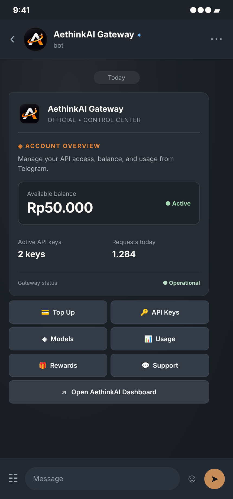
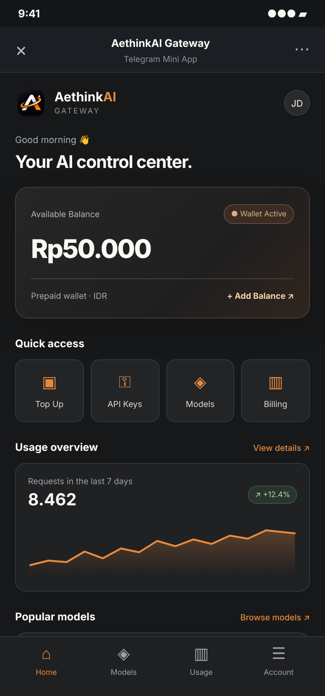
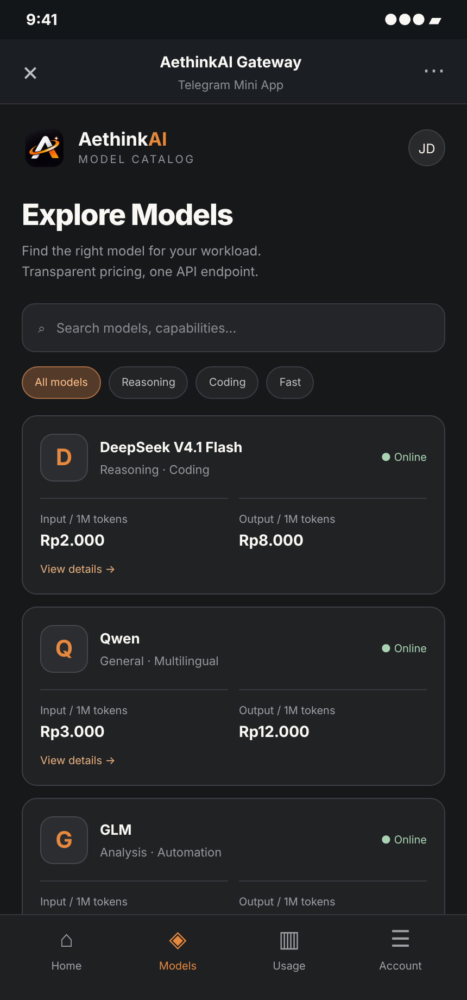

# AethinkAI Gateway — Telegram Bot + Mini App UI/UX PRD

**Untuk:** Agent Hermes  
**Jenis pekerjaan:** Audit, desain ulang, dan implementasi antarmuka Telegram bot yang terintegrasi dengan AethinkAI Gateway  
**Konsep:** **AethinkAI Minimal Command Center**  
**Prioritas:** Bot chat yang cepat dan rapi, ditambah Telegram Mini App dengan UI premium  
**Bahasa antarmuka:** Bahasa Indonesia sebagai default; siapkan struktur i18n bila proyek sudah mendukungnya.

> **INSTRUKSI UTAMA UNTUK HERMES:** Inspeksi proyek AethinkAI dan bot Telegram yang sudah ada terlebih dahulu. Pertahankan arsitektur, API, bot token, database, metode pembayaran, endpoint, dan workflow yang sudah berfungsi. Jangan membangun sistem wallet kedua, jangan mengubah landing page di luar kebutuhan integrasi, dan jangan membuat transaksi/kredit palsu pada lingkungan production. Implementasikan desain sesuai referensi di bawah, bukan sekadar menjelaskan konsep.

---

## 1. Referensi visual wajib

Gambar berikut dibuat sebagai **acuan desain UI (mockup), bukan screenshot aplikasi yang sudah berjalan**. Ikuti struktur, proporsi, hierarki, padding, warna, dan cara penyajian data. Semua angka saldo, request, harga, dan status adalah **data ilustrasi**, bukan harga atau status operasional AethinkAI sesungguhnya.

### A. Telegram chat bot — Home / Account Overview



**File:** `references/01-telegram-chat-home.png`

Fokus: satu pesan utama yang bersih, saldo paling menonjol, ringkasan API key/request/status, dan inline keyboard dua kolom. Hindari spam banyak pesan saat pengguna membuka menu. **Warna dan bentuk tombol inline keyboard asli ditentukan klien Telegram, bukan HTML/CSS bot; gambar ini menunjukkan komposisi, bukan kemampuan mengubah native button.**

### B. Telegram Mini App — Dashboard / Home



**File:** `references/02-miniapp-home.png`

Fokus: mini dashboard premium mobile-first. Saldo IDR jelas, shortcut Top Up/API Keys/Models/Billing, grafik usage, model populer, bottom navigation. Mini App dapat memakai HTML/CSS/React yang benar-benar disesuaikan dengan brand.

### C. Telegram Mini App — Model Catalog



**File:** `references/03-miniapp-model-catalog.png`

Fokus: pencarian, filter model, nama dan kemampuan model, harga terpisah input/output per 1 juta token, status, dan detail. Harga pada gambar hanyalah contoh. Jangan hard-code sebagai tarif riil.

### D. Asset identitas


**File:** `references/aethinkai-brand-icon.png` — asset logo AethinkAI diambil dari gambar brand yang sudah digunakan, untuk menghindari ikon pengganti yang generik. Gunakan asset brand asli yang tersedia di proyek jika resolusi atau formatnya lebih baik.

---

## 2. Product vision

Telegram bot AethinkAI bukan sekadar toko digital berbasis daftar tombol. Ia adalah **companion control center** untuk pelanggan layanan API Gateway:

- **Bot chat:** cek saldo, notifikasi, navigasi cepat, transaksi/top up, status key, dan bantuan.
- **Telegram Mini App:** pengalaman store/dashboard visual premium untuk top up, katalog model dan harga, aktivitas pemakaian, billing, serta pengelolaan akun.
- **AethinkAI Web Dashboard:** tetap menjadi tempat utama untuk manajemen kompleks dan pekerjaan developer.

**Satu akun, satu saldo, satu ledger transaksi, satu katalog model.** Telegram dan website membaca backend AethinkAI yang sama. 9Router tetap merupakan downstream routing layer dan bukan sumber kebenaran wallet pelanggan.

**Jangan** membuat database saldo bot yang terpisah. **Jangan** menjadikan Telegram bot jalur API alternatif yang menghitung usage/token secara independen.

---

## 3. Identitas desain / design tokens

| Elemen | Token | Catatan |
|---|---|---|
| Background | `#18191B` | Dark charcoal matte |
| Surface / card | `#232426` | Card premium |
| Surface hover | `#2B2D30` | Sedikit lebih terang |
| Border | `#383A3E` | Tipis dan tenang |
| Primary text | `#FAF8F4` | Warm white |
| Muted text | `#A1A3A7` | Tetap terbaca |
| Accent | `#E7893C` | Copper orange utama |
| Burnt orange | `#9C542F` | Detail sekunder |
| Success state | warna hijau lembut | **Hanya** untuk status positif terverifikasi |

Visual rules:

1. **Premium minimal SaaS**, bukan cyberpunk, bukan neon AI, bukan glassmorphism berat.
2. Layout sederhana, jarak antarkomponen teratur, border halus, shadow ringan.
3. Accent orange dipakai untuk CTA/active state, jangan semua komponen diberi glow.
4. Emoji dibatasi di chat untuk membantu identifikasi menu; Mini App memakai icon set konsisten.
5. Typography modern seperti Inter bila tersedia; pastikan fallback font aman.
6. Animasi singkat sekitar 150–220 ms; hindari 3D berlebihan dan animasi yang mengganggu pembacaan angka.
7. Responsif di viewport Telegram mobile sempit; hormati safe-area dan warna tema Telegram.

---

## 4. Telegram native bot — struktur dan perilaku

### 4.1 `/start` / Home

Tampilkan satu pesan ringkas dengan isi:

- Identitas: **AethinkAI Gateway · Control Center**.
- Sambutan singkat yang tidak bertele-tele.
- **Available Balance: Rp...** (dari backend yang sama dengan web).
- Jumlah API key aktif (tanpa membocorkan key penuh).
- Requests hari ini, jika ada endpoint metrik terpercaya.
- Status gateway hanya bila ada data aktual, jangan klaim “Operational” secara fiktif.
- Waktu pembaruan informasi bila relevan.

Inline keyboard, dua kolom:

| Kiri | Kanan |
|---|---|
| 💳 Top Up | 🔑 API Keys |
| ◈ Models | 📊 Usage |
| 🎁 Rewards | 💬 Support |
| **🌐 Open Dashboard / Mini App** | *(tombol full-width)* |

**Penting:** tombol di chat adalah tombol native Telegram. Jangan mencoba memberi custom CSS pada inline keyboard. Desain “premium” datang dari teks yang rapi, hirarki informasi, navigasi cepat, media yang tepat guna, serta pengalaman Mini App.

### 4.2 Prinsip navigasi

- Gunakan `editMessageText` / `editMessageCaption` dan `editMessageReplyMarkup` secara tepat ketika berpindah halaman menu, agar chat tidak penuh pesan lama.
- Jawab callback query (`answerCallbackQuery`) agar loading di tombol tidak menggantung.
- Setiap submenu memiliki `← Back` dan `⌂ Home` jika diperlukan.
- Jangan edit pesan yang sudah tidak bisa diedit; gunakan fallback mengirim pesan baru secara aman.
- Tangani callback lama, retry, double tap, rate limit Telegram `429`, dan state yang kadaluarsa.
- Simpan state navigasi secukupnya dan validasi kepemilikan user.
- Gunakan /start, /menu, /balance, /topup, /models, /help jika sesuai dengan command yang sudah ada. Jangan menimpa flow lama tanpa audit.

### 4.3 Submenu Top Up

- Pilih nominal yang didukung backend/payment gateway.
- Tampilkan nominal, metode pembayaran, status, invoice ID, dan batas waktu bila tersedia.
- Payment lewat sistem yang **sudah ada**, bukan mock QRIS yang diklaim nyata.
- Konfirmasi pembayaran hanya dari transaksi yang **terverifikasi server**.
- Setelah sukses, tampilkan `saldo sebelum`, `top up`, dan `saldo terbaru` dari backend.
- Jangan memperbarui saldo hanya karena user menekan tombol “Sudah Bayar”.

### 4.4 Submenu API Keys

- Tampilkan daftar key dalam bentuk label/nama, masked prefix/suffix, tanggal pembuatan, status, dan tombol ke dashboard.
- **Jangan kirim API key lengkap berulang-ulang ke chat.** Lebih aman buat/lihat secret hanya di alur dashboard terautentikasi dengan one-time reveal sesuai backend.
- Aksi sensitif: verifikasi identitas, konfirmasi, log audit, dan rate limit.

### 4.5 Submenu Models

- Tampilkan daftar/kategori/model pilihan dan tautan ke katalog di Mini App.
- Tunjukkan tarif **IDR per 1M tokens**: input, output, serta cached input jika model mendukung.
- Nama model, route, dan harga harus dari AethinkAI catalog, bukan daftar statis dari mockup.
- Status model hanya dari health/availability sebenarnya.

### 4.6 Submenu Usage & Billing

- Ringkasan request 24 jam / 7 hari jika tersedia.
- Total token input, output, cached, dan pengeluaran saldo jika data tersedia.
- Riwayat top up dan usage sebagai catatan terpisah agar tidak membingungkan.
- Sediakan link ke halaman laporan lengkap.

### 4.7 Rewards & Support

- Rewards/Bansos mengikuti program promo yang **benar-benar aktif** pada sistem.
- Support membuka kanal bantuan yang sudah ada di proyek.
- Jika reward belum diimplementasikan, tampilkan state “Belum tersedia”, bukan klaim promo aktif.

---

## 5. Telegram Mini App — UI screen specification

### 5.1 Home / Overview

Lihat `references/02-miniapp-home.png`.

Komponen dalam urutan:

1. Top bar ringkas dengan branding AethinkAI.
2. Greeting dan status akun bila perlu.
3. **Wallet balance** besar, format `Rp50.000` (angka ilustratif).
4. Shortcut empat tombol: Top Up, API Keys, Models, Billing.
5. Usage chart sederhana, misalnya 7 hari terakhir.
6. Model populer dari katalog aktual.
7. Bottom navigation: Home, Models, Usage, Account.

Hindari terlalu banyak widget. Fokus pada angka penting dan aksi yang sering dilakukan.

### 5.2 Model Catalog

Lihat `references/03-miniapp-model-catalog.png`.

- Search nama/model ID.
- Filter kategori jika datanya tersedia.
- Provider/model name, capability, tarif input/output per 1M tokens.
- Model detail menampilkan context length, tool support, vision support, dan token billing **hanya bila metadata tersedia**.
- Harga tetap IDR dan dipisahkan input/output/cached input.
- Pricing menggunakan source-of-truth catalog yang sama dengan web AethinkAI.

### 5.3 Wallet / Top Up

- Saldo saat ini, nominal preset, nominal custom jika didukung.
- Ringkasan biaya/payment fee sebelum konfirmasi.
- Invoice/payment state: pending, paid, expired, failed; refresh dari server.
- Riwayat top up dan bukti transaksi jika backend menyediakannya.
- Empty, loading, timeout, and retry states jelas.

### 5.4 API Key Management

- Nama key, status, paket/permission jika berlaku, masked identifier, last used jika tersedia.
- Buat key atau revoke hanya lewat endpoint aman yang sudah ada; aksi sensitif memerlukan confirmation.
- Jangan menyimpan secret permanen di localStorage atau Telegram chat history.
- Beri petunjuk penggunaan Base URL dan dokumentasi API.

### 5.5 Usage & Billing

- Ringkasan konsumsi IDR, request count, token input/output/cache.
- Breakdown per model dan periode.
- Grafik ringan dan ramah mobile.
- Riwayat debet wallet dan transaksi top up punya label serta status yang mudah dibedakan.

### 5.6 Account, Support, Rewards

- Status akun tertaut Telegram ↔ AethinkAI, serta opsi unlink bila backend mendukung.
- Preferensi notifikasi: balance low, payment success, key/security alerts.
- Support dan Rewards/Bansos dari sistem eksisting.

---

## 6. Sinkronisasi Telegram ↔ AethinkAI — prinsip wajib

**Arsitektur yang diinginkan:**

```text
Telegram User
   |-- Native Telegram Bot (chat commands, quick actions, notifications)
   |-- Telegram Mini App (premium visual wallet / catalog / usage)
               |
      AethinkAI Backend API
               |-- Identity / Telegram account link
               |-- One Wallet + IDR ledger
               |-- Customer API Keys & Permissions
               |-- Models & Pricing Catalog
               |-- Usage / Billing / Transactions
               |
             9Router
               |
      Actual upstream AI providers
```

Aturan sinkronisasi:

1. Identitas Telegram dipetakan ke **satu customer AethinkAI** menggunakan alur linking yang terverifikasi. Jangan percaya username Telegram sebagai identitas yang pasti atau permanen.
2. Untuk Mini App, validasi **Telegram `initData` di server**, periksa `auth_date` dan signature/hash; jangan percaya `initDataUnsafe` mentah sebagai login.
3. Pertahankan auth website yang sudah ada; jangan membuat login bypass hanya karena Mini App dibuka dari Telegram.
4. Satu saldo IDR dengan ledger transaksi yang sama untuk web dan bot. Hindari `credits` alternatif kecuali produk existing benar-benar memerlukannya.
5. Gunakan kalkulasi billing presisi tinggi untuk pecahan rupiah; jangan membulatkan setiap request ke Rp1 secara serampangan.
6. API key, model catalog, dan usage menggunakan backend yang sama. Jangan sinkronisasi dengan menduplikasi database secara manual.
7. Top up bersifat idempotent (`payment_id` / webhook event ID) supaya satu payment tidak mengkredit saldo lebih dari sekali.
8. Token bot Telegram, secret payment, private credentials, dan API key admin harus ada di environment/secret manager server. Tidak dikirim ke frontend, log, atau screenshot.
9. Bot Telegram **tidak mengirim request model melalui bot sebagai substitusi gateway** kecuali ada requirement produk tersendiri; bot ini adalah antarmuka akun/store.
10. Jika backend AethinkAI belum siap, gunakan mock adapter untuk UI **secara eksplisit bertanda demo**. Jangan menampilkan data demo sebagai transaksi aktual.

---

## 7. UX flows penting

### Flow A — Pertama kali membuka bot

`/start` → identifikasi Telegram user → cek apakah sudah link ke akun AethinkAI → jika belum, tampilkan “Connect AethinkAI Account” → proses linking aman → kirim account overview.

### Flow B — Top up saldo

`Home` → `Top Up` → pilih nominal → buat invoice melalui backend → tampilkan invoice/status → webhook terverifikasi → saldo wallet sama di website dan bot → notifikasi berhasil.

### Flow C — Cek model dan harga

`Home` → `Models` → ringkasan menu atau buka Mini App → filter model → lihat harga per 1M input/output tokens dari catalog → detail integrasi.

### Flow D — Kelola API key

`Home` → `API Keys` → tampilkan daftar key yang dimask → buka dashboard yang aman untuk create/revoke atau pengaturan detail → data terbaru terlihat juga pada bot.

### Flow E — Notifikasi

Backend event → queue/dispatcher notifikasi (jika sudah ada) → bot Telegram → pesan singkat, tidak berulang, tidak membocorkan secret.

---

## 8. Micro-interaction dan responsiveness

- Mini App entrance: fade/translate lembut 150–220ms.
- Press state pada card/button: background dan border berubah halus.
- Loading skeleton untuk saldo, cards, katalog.
- Toast sukses/error spesifik dan aksesibel.
- Tap target minimal sekitar 44px.
- Gunakan `Telegram.WebApp` SDK sesuai versi/dependency di proyek.
- Dukung light/dark theme Telegram sejauh tidak mengorbankan brand; default desain dark.
- Pastikan keyboard mobile tidak menutup search/input/topup.
- Hormati safe area, viewport resize, dan tombol Back Telegram.
- Render error, offline/timeout, empty, unauthorized, dan akun belum tertaut secara eksplisit.

---

## 9. Langkah kerja Hermes (wajib)

1. **Audit existing code**: framework frontend, bot library, API routes, account model, saldo, transaksi, callback handlers, katalog model, deployment.
2. Buat ringkasan singkat apa yang sudah ada dan apa yang belum tersedia. **Jangan mengarang endpoint.**
3. Implementasikan/refactor **native chat home** sesuai gambar `01` dan menu navigation.
4. Implementasikan/refactor **Mini App Home** sesuai gambar `02` memakai stack yang sudah ada.
5. Implementasikan **Mini App Model Catalog** sesuai gambar `03`.
6. Integrasikan read/write operation dengan backend yang ada jika endpoint dan kredensial tersedia secara aman. Jika belum, pisahkan mock adapter beserta API contract yang dibutuhkan.
7. Tambahkan account linking, validation, dan secure payment flow sesuai kemampuan sistem eksisting. Jangan menciptakan skema identitas atau payment baru tanpa kebutuhan nyata.
8. Pastikan tidak merusak landing page, dashboard web, maupun flow transaksi yang sudah live.
9. Jalankan build, typecheck/lint, dan test yang tersedia. Jangan klaim lulus bila tidak dijalankan.
10. Lampirkan bukti hasil: screenshot chat bot, Mini App Home, Model Catalog, dan summary perubahan file serta endpoint yang dipakai.

**Bila lingkungan development atau bot token live belum tersedia:** implementasikan UI dengan mock data yang diberi label demo dan berikan langkah integrasi, bukan memaksa eksekusi pada production.

---

## 10. Acceptance criteria

- [ ] Native Telegram home lebih bersih dan navigasi tombol konsisten.
- [ ] Mini App sesuai palet brand; tidak AI slop/neon, tidak sekadar HTML mockup statis.
- [ ] Gambar referensi 01, 02, 03 benar-benar digunakan sebagai pedoman layout.
- [ ] Website dan Telegram bot menampilkan **saldo customer yang sama**.
- [ ] Tidak ada database wallet atau logika tarif bayangan di bot.
- [ ] API keys tidak bocor dalam chat dan tidak dimasukkan ke bundle frontend.
- [ ] Payment webhook/confirmation diproses aman, sekali untuk satu event.
- [ ] Katalog model/harga berasal dari backend, bukan dari angka ilustrasi mockup.
- [ ] Semua tombol mempunyai aksi nyata atau disabled/coming soon yang jujur.
- [ ] Navigasi nyaman di perangkat mobile dan tidak merusak tombol Telegram.
- [ ] Empty/loading/error state tersedia untuk data yang bergantung jaringan.
- [ ] Tidak ada perubahan destruktif di database, auth, web landing, atau provider routing.
- [ ] Hasil akhir disertai screenshot dan ringkasan teknis.

---

## 11. Peringatan untuk implementasi visual

**Jangan menyalin bingkai status bar dan toolbar aplikasi Telegram ke dalam HTML Mini App.** Bingkai itu pada mockup hanya menunjukkan konteks perangkat. Telegram asli sudah menyediakan status bar, toolbar, close button, dan UI host-nya sendiri. Implementasikan **hanya konten Mini App di dalam viewport** dan pastikan integrasi SDK yang benar.

**Jangan menampilkan logo/text “verified” seolah ada centang resmi Telegram jika belum diverifikasi.** Simbol di screenshot chat hanya ilustrasi tampilan aplikasi.

**Jangan mengunci nominal atau harga contoh.** Semua contoh `Rp50.000`, `1.284`, `8.462`, dan `Rp2.000 / 1M` adalah dummy untuk membantu desain.

**Target akhir:** bot AethinkAI yang ringan untuk navigasi cepat, Mini App yang terasa seperti SaaS premium, dan data akun yang konsisten dengan web dashboard AethinkAI.
