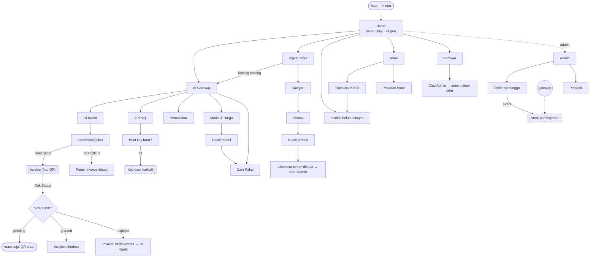
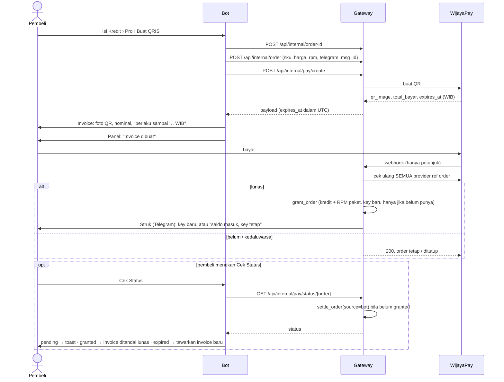

# Telegram bot: screen map and the bot ↔ gateway flow

File: `bot/bot.py`. Tests: `bot/tests/test_bot_flow.py` (fake Telegram + fake gateway,
no network). Gateway side: `gateway/app/payments.py` (`settle_order`, `notify_buyer`),
`gateway/app/portal.py` (`/api/internal/*`, `grant_order`).

## 1. Who owns what

| Piece | Owns | Never does |
|---|---|---|
| Bot | Rendering panels, collecting taps, relaying to the gateway | Holding money, keys or prices |
| Gateway | Orders, QRIS, settlement, balances, keys, usage, catalogue | Rendering menus (except the payment receipt) |
| WijayaPay | QR creation and payment status | Deciding credit: the gateway re-checks before granting |

The gateway sends the payment receipt itself (same bot token), so a payment is
confirmed to the buyer even when the bot process is down.

## 2. Screen map

One **panel** message is edited as the buyer navigates. **Standalone** messages
(dashed) are sent separately and carry no navigation callbacks, so navigating can
never overwrite an invoice, a key or a receipt.



Shortcuts left out of the diagram for readability: AI Gateway → Digital Store,
Akun → API Key / Pemakaian, and Cek Status on the invoice panel.

Every panel except Home has `‹ Menu Utama` or a `‹` back button; the crawler test
(`test_every_panel_has_a_way_home`) presses every reachable button to prove it.

## 3. Buying credit (QRIS)



Manual mode (no QRIS provider configured): the invoice shows `Saya sudah bayar`,
admins get a `Grant sekarang` button, and `do_grant` sends the same receipt layout.

## 4. Rules the bot follows

- **Private chat only.** Commands in a group get a pointer to the private chat;
  callbacks from a group are refused. Balance, keys and invoices never render in groups.
- **Confirm before charging.** A package tap opens a confirmation; the QR is created
  only on `Buat QRIS`. Old `buy:<sku>` buttons from previous messages open the same
  confirmation.
- **Status checks don't destroy the QR.** `Cek Status` on an unpaid invoice answers
  with a toast; the photo and its buttons stay.
- **Time is WIB.** The gateway stores UTC; the bot converts for display.
- **Money is `Rp25.000`.** One formatter (`rupiah`), dots for thousands, no space.
- **RPM shown is the key's real RPM** (`keys[0].rpm_limit` from the snapshot), not a default.
- **Models are referenced by id** in callbacks, so a catalogue reorder between list
  and tap still opens the right model.
- **Edits fall back to a new message** when Telegram refuses an edit (photo, deleted),
  except for `message is not modified`. 429s wait `retry_after`.
- **Key rotation asks first**, also for `/rotate`. The new key is a standalone message
  with link buttons only.

## 5. Callback namespaces

| Prefix | Meaning |
|---|---|
| `ui:home`, `ui:gw:*`, `ui:st:*`, `ui:acct*`, `ui:help`, `ui:order:<id>`, `ui:admin*` | navigation (edit panel) |
| `qr:<sku>` | create order + QR |
| `pay:<order>` | check payment status |
| `paid:<order>` | manual mode: buyer says paid |
| `g:<order>` | admin grant |
| `rot:ask`, `rot:yes` | key rotation |
| `s:ping` | notify admins (rate-limited, 2 per 10 min) |
| `m:*`, `buy:<sku>`, `ui:activity*`, `ui:help:st/gw` | legacy, mapped to the new screens |

Unknown callbacks land on Home with a short toast instead of a silent spinner.

## 6. Where the Digital Store plugs in

`store_catalog()` is the only adapter. It returns `[]` today, so:

- Home says `Katalog sedang disiapkan`, the store panel says so too and links to AI Gateway.
- Category, product and detail screens are implemented and tested against an
  injected catalogue; `Beli` opens `Checkout belum dibuka` with `Chat Admin`.

To open the store, implement docs/STORE_DESIGN.md phases 0–2 on the gateway, then:

1. `store_catalog()` → `GET /api/store/products`.
2. `ui:st:buy:<id>` → variant/quantity confirmation, then a `qr:` equivalent that calls
   `POST /api/store/orders` + `/pay` (same payment core, `target='store'`).
3. Delivery is pushed by the gateway like the credit receipt; `Pesanan Store` lists
   `GET /api/store/orders`.

## 7. Running the tests

```
python -m pytest bot/tests/test_bot_flow.py
python -m pytest gateway/tests/test_settle_refs.py gateway/tests/test_buyer_receipt.py
```

`bot/tests/e2e_bot.py` still needs a running gateway and Postgres.
